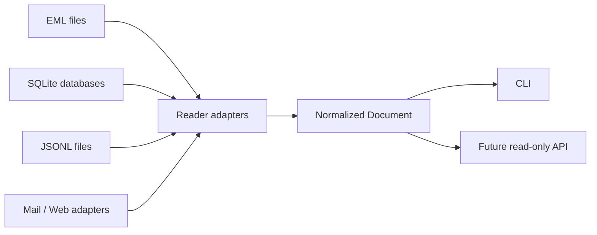

# Goemon Reader Architecture

## Responsibility boundary

Goemon is a read-only information access layer. It opens source systems, converts records to normalized Documents and exposes them through CLI/API surfaces.

Out of scope:
- Agent planning and orchestration
- Worker process lifecycle
- Image generation and model inference
- Sending mail or mutating source databases

Those runtime responsibilities are assigned to `bons.ai-swarm`.

## Data flow

## Package boundaries

- `internal/document`: source-neutral Document model
- `internal/reader`: Reader interface and shared contracts
- `internal/reader/eml`: EML file adapter
- `internal/reader/jsonl`: JSONL streaming adapter
- `internal/reader/sqlite`: read-only SQLite adapter
- `cmd/goemon`: command-line entry point

## Document contract

A Document carries a source label, source-local identity, title/body, content type, timestamps, source-specific metadata and a raw reference. The raw source remains authoritative; the Document is a read model.

## Safety invariants

1. Reader adapters do not write to source systems.
2. SQLite connections use read-only and query-only flags.
3. JSONL parsing is streaming and reports malformed line numbers.
4. Credentials are never embedded in source code.
5. Future network readers must define URL allowlists, timeouts and size limits before release.

## Planned extensions

- IMAP mail reader with external credential configuration
- Web URL reader with SSRF protections
- Search/index layer
- Interactive keyboard-first CLI (peco-like)
- Read-only HTTP API
- Rich MIME attachment extraction and raw export
